https://github.com/supersonicjellybean/aspire-es1-531-p7kk-pentium-N3710-Investigation


| **Metric**             | Value                                   |
| ---------------------- | --------------------------------------- |
| Make                   | Acer Aspire ES1-531-P7KK                |
| Processor              | Intel Pentium N3710                     |
| Base Frequency         | 1600MHz                                 |
| Burst Frequency        | 2560MHz                                 |
| RAM                    | 1x4096MB DDRL3 @ 1600MHz                |
| Primary Storage Device | Toshiba 1TB 5400RPM HDD                 |
| GPU                    | Intel HD 405                            |
| Socket                 | Socket 1170 BGA                         |
| BIOS                   | Insyde Corp. V1.22 (11/30/2016)         |
| CPU-Z Validator ID     | arcgyt                                  |
| Reported Frequency     | 479.8 MHz                               |
| BCLK Frequency         | 79.97 MHz                               |
| Current Multiplier     | 6x                                      |
| VCore                  | 0.45V                                   |
| Microcode Rev.         | 0x408                                   |
| Temperature            | 57 °C / 135 °F                          |
| Windows Version        | Microsoft Windows 10 Professional (x64) |
<div align="center">Table 0A: Basic Information</div>

Observed Fault: The system never appears to reach its regular clock speeds of ~1600MHz and tends to stick to 480MHz on both battery and AC power.
### Hypothesis 1:
 CPU-Z shows a BCLK of 80MHz, which is quite abnormal, as most Intel chips from this era have a BCLK (Base/Bus Clock) of 100MHz. While having an 80MHz BCLK rather than a 100MHz BCLK wouldn’t make the clock multiplier plummet, it is an inconsistency that should be addressed.
 
#### Investigation:
Using CPU-Z, I created a CPU-Z Validator export from my device to cross reference data from other users on the same platform, namely, references [A](https://valid.x86.fr/kgxyxn), [B](https://valid.x86.fr/ctxfls), and [C](https://valid.x86.fr/rx7r0n). My export can be found [here](https://valid.x86.fr/arcgyt).

| Metric             | [Reference A](https://valid.x86.fr/kgxyxn) | [Reference B](https://valid.x86.fr/ctxfls) | [Reference C](https://valid.x86.fr/rx7r0n) | [My Device](https://valid.x86.fr/arcgyt) |
| ------------------ | ------------------------------------------ | ------------------------------------------ | ------------------------------------------ | ---------------------------------------- |
| CPU-Z Validator ID | kgxyxn                                     | ctxfls                                     | rx7r0n                                     | arcgyt                                   |
| Reported Frequency | 2558.95 MHz                                | 2558.95 MHz                                | 2558.95 MHz                                | 479.8 MHz                                |
| BCLK Frequency     | 79.97MHz                                   | 79.97MHz                                   | 79.97MHz                                   | 79.97 MHz                                |
| Current Multiplier | 32x (maximum)                              | 32x (maximum)                              | 32x (maximum)                              | 6x (minimum)                             |
| VCore              | 0.86V                                      | 0.98V                                      | 1.00V                                      | 0.45V                                    |
| Microcode Rev.     | 0x411                                      | 0x411                                      | 0x411                                      | 0x408                                    |
| Temperature        | 57 °C / 135 °F                             | 73 °C / 163 °F                             | 85 °C / 185 °F                             | 57 °C / 135 °F                           |
<div align="center">Relevant Data from CPU-Z Validator References A, B, C, and my own report</div>

There are immediate discrepancies visible, specifically, the clock multiplier is at the minimum allowed state (6x), as observed before, and the microcode version is different from that observed on other reference machines. It’s unlikely that the microcode is the reason for the clock issues, because this behavior would be well documented had this bug shipped with the many devices that came with microcode 0x408. Another observation is that the VCore is at 0.45V, which is absurdly low. However, I believe this to be a symptom, rather than the root cause, because if the system was expecting higher voltages and was being under-supplied power, it’d face kernel panics and general instability, which hasn’t been observed. It makes more sense to assume that the OS or the processor itself is enforcing a lower clock speed, and thus VCore lowers due to DVFS (Dynamic Voltage and Frequency Scaling).

It is quite clear that the BCLK is, in fact, ~80MHz for CPU’s on this platform. As such, we can confirm that Hypothesis 1 fails to explain observed behaviour adequately.

### Hypothesis 2:
The throttling might not be due to Windows mishandling the processor, but rather an ACPI/Firmware/EC bug, or a potential hardware defect, like a broken clock generator.

#### Investigation:
Despite Windows being configured to keep the processor’s minimum and maximum state at 100%, the processor remained hovering at ~0.48GHz. To eliminate any chances of OS mismanagement regarding power states, I will use antiX Linux to observe CPU frequency under both idle and stressed conditions under the default schedutil and performance governor. Should Linux also exhibit the same behavior under both governors, OS mismanagement can be ruled out as a factor, and would point to some form of throttling enforced by the firmware itself.

Since the known baseline from windows was 480MHz, the goal on antiX was to compare against the windows baseline by. This will be done by sampling the CPU frequency every 0.1 seconds, gathering a total of 3000 samples, allowing us to not only compare against the windows baseline but also potentially find patterns in the data by using the following script:

```bash
for i in {1..3000}; do
ts=$(date +%s.%3N)
freqs=$(cat /sys/devices/system/cpu/cpu*/cpufreq/scaling_cur_freq | paste
-sd,)
echo "$ts,$freqs" >> cpu_freqs.csv
sleep 0.1
done
```

Graphing the data obtained on a Frequency-Sample chart (source code for python grapher available on project [repo](https://github.com/supersonicjellybean/aspire-es1-531-p7kk-pentium-N3710-Investigation).)

A. Idle (default governor)
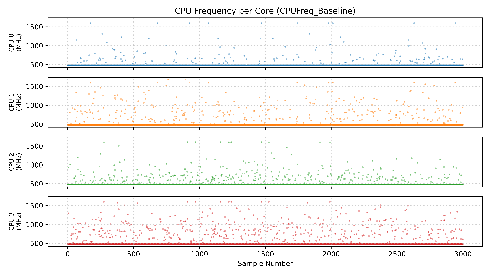
<div align="center">Graph 2A: Frequency-Sample graph under Idle conditions</div>

B. Under load (default governor)
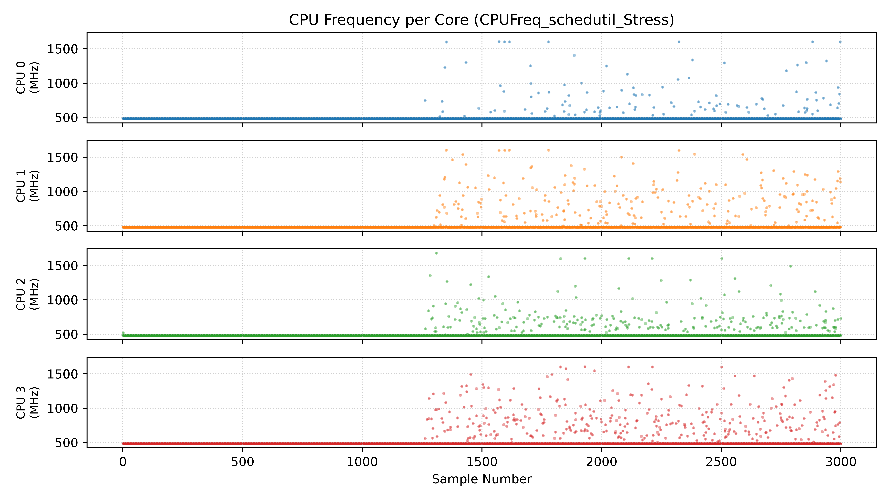
<div align="center">Graph 2B: Frequency-Sample graph under load (default governor)</div>

C. Under load (performance governor)
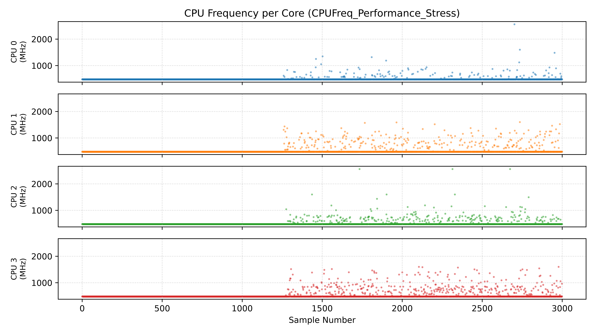
<div align="center">Graph 2C: Frequency-Sample graph under load (performance governor)</div>

In a perfect test, the logger would have taken exactly 5 minutes. However, in real-world use, it took an average of 553.32 seconds, or around 9 minutes and 13 seconds due to the overhead of spawning multiple subprocesses per log.

From the data observed, we can make a few observations:

1. The issue with CPU frequency was independent of Operating Systems.
2. The logging program was hardwired to take 3000 samples with an interval of 0.1seconds. However, due to experimental error, every execution had an average interval of 0.164242667s (Graph 2A), 0.194385s (Graph 2B), and 0.194692333s (Graph 2C). While these numbers seem  to be a negligible delay, each delay pushed the timing by several seconds in each test case. Due to this, an unintended observation can be made; graphs 2B and 2C show both the CPU frequency activity under load, and activity immediately after load. Reevaluating the same graphs, no activity over 480MHz is observed for the initial ~1250 samples. The CPU Frequency apparently goes over 480MHz only when the system is idle.

### Hypothesis 3:
Since the processor only appears to throttle under C0 states (non-idle), it is possible that when the operating system selects a P-state (performance state) and hands the processor the V/F pair (defines a CPU’s clock speed and the voltage required to run it safely), the processor’s power management controller attempts to scale accordingly, but throttles for some reason.

BD\_PROCHOT is a hardware safety signal that forces a processor to ‘slow down’. It can be asserted by the EC in case of a failing/degraded component on the motherboard, such as Power ICs, battery controllers, etc. 

#### Investigation:
PROCHOT# is an active-low electrical signal to the processor. A pull up resistor keeps the PROCHOT#\_CPU line at a stable voltage (either 1.8V or 3.3V) and above VIL (logic low threshold) during normal operation. PROCHOT# and BD\_PROCHOT are two different methods of triggering the PROCHOT# trip, which in turn throttles the CPU. BD\_PROCHOT is an input to the CPU, whereas when internal PROCHOT# is asserted courtesy of the CPU’s internal Digital Thermal Sensors, PROCHOT#\_CPU serves as TX to broadcast that it’s throttling.

Regardless of the manner of assertion, when a PROCHOT# trip is active, the processor lowers itself to the minimum allowed frequency (LFM) as a safety mechanism to prevent damage to the system.

Tools exist to ‘disable’ BD_PROCHOT entirely, as it is known to cause performance issues much like what I was seeing. However, [ThrottleStop](https://www.techpowerup.com/download/techpowerup-throttlestop/), a well known utility for altering CPU behavior, including disabling BD_PROCHOT, showed the  “BD_PROCHOT” box to be greyed out and unchecked.

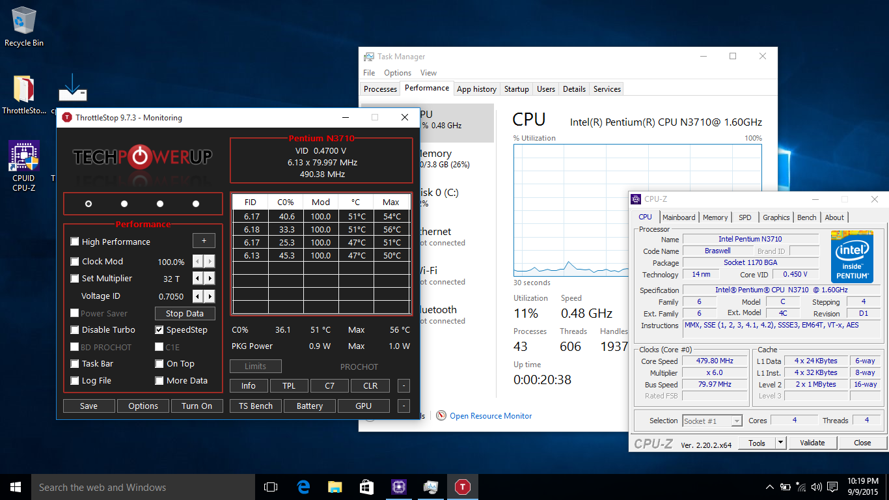
<div align="center">Image 3A: ThrottleStop showing greyed out and unchecked “BD_PROCHOT” box</div>

As BD_PROCHOT is a physical safety mechanism, it cannot simply be ‘turned off’. Instead, clearing bit 0 of MSR 0x1FC acts as a logical mask inside the processor, forcing the hardware to ‘ignore’ the BD_PROCHOT signal regardless of the line's physical voltage. Indeed, this is what popular tools like ThrottleStop do to ‘disable’ BD_PROCHOT.

Since ThrottleStop greyed out the BD_PROCHOT box, I used another program designed to read, inspect, and modify almost all computer hardware settings, [RWEVerything](https://rweverything.com/).

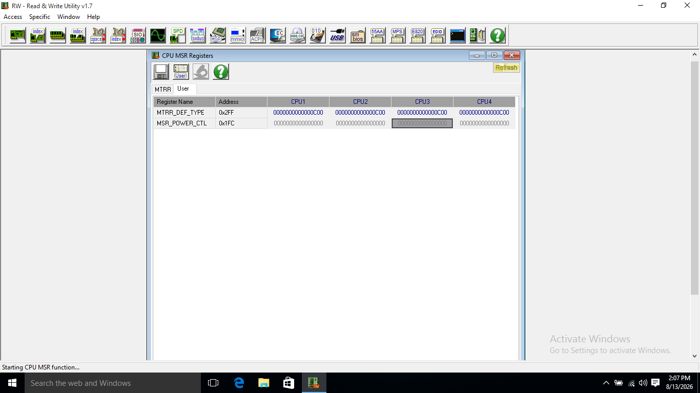
<div align="center">Image 3B: RWEverything window showing results of querying MSR 0x1FC</div>

Querying MSR 0x1FC using RWEverything returned a 64-bit hexadecimal zero (0x0000000000000000) that was greyed out. It was unclear whether the register held an active zero value (PROCHOT# not asserted) or if the program was encountering an error trying to read the register address. After almost a week of cross-referencing RWEverything screenshots and forum threads without finding a single documented case of this on a Braswell chip, a reference pointed me to documentation I didn't know existed, the [Intel® 64 and IA-32 Architectures Software Developer Manuals](https://www.intel.com/content/www/us/en/developer/articles/technical/intel-sdm.html), Volume 4: Model-Specific Registers. It details what registers were available on each processor family and their corresponding microarchitecture (here, the 06_4CH family, on the ‘Airmont’ microarchitecture). Indeed, 0x1FC was not listed in any of the corresponding tables. As such, there is not enough information to confirm or deny if BD_PROCHOT is active.

### Hypothesis 4:
Since there is not enough data to make a conclusion on Hypothesis 3, as reflected above, we must consider other possibilities. It is possible that the severe frequency throttling is being triggered by other CPU safety mechanisms, like an active thermal safeguard or power constraint causing the drop in frequency. This can be verified by reading the processor’s MSRs, which are special registers that contain ‘toggles’ and ‘telemetry’ regarding the CPU state.

#### Investigation:
Using Intel’s SDM Volume 4, MSRs potentially relevant to throttling, performance states, power limits, performance telemetry, and power consumption were shortlisted.

<div align="center">
  <table>
    <thead>
      <tr>
        <th align="left">Register Name</th>
        <th align="left">Register Address</th>
      </tr>
    </thead>
    <tbody>
      <tr><td>IA32_PERF_STATUS</td><td>0x198</td></tr>
      <tr><td>IA32_PERF_CTL</td><td>0x199</td></tr>
      <tr><td>IA32_THERM_STATUS</td><td>0x19C</td></tr>
      <tr><td>MSR_PKG_POWER_LIMIT</td><td>0x610</td></tr>
      <tr><td>MSR_PLATFORM_INFO</td><td>0xCE</td></tr>
      <tr><td>MSR_FSB_FREQ</td><td>0xCD</td></tr>
    </tbody>
  </table>
</div>
<div align="center">Table 4A: List of shortlisted MSRs (sourced from Intel SDM Vol.4, “MSRs in Intel Atom® Processors Based on Airmont Microarchitecture”)</div>

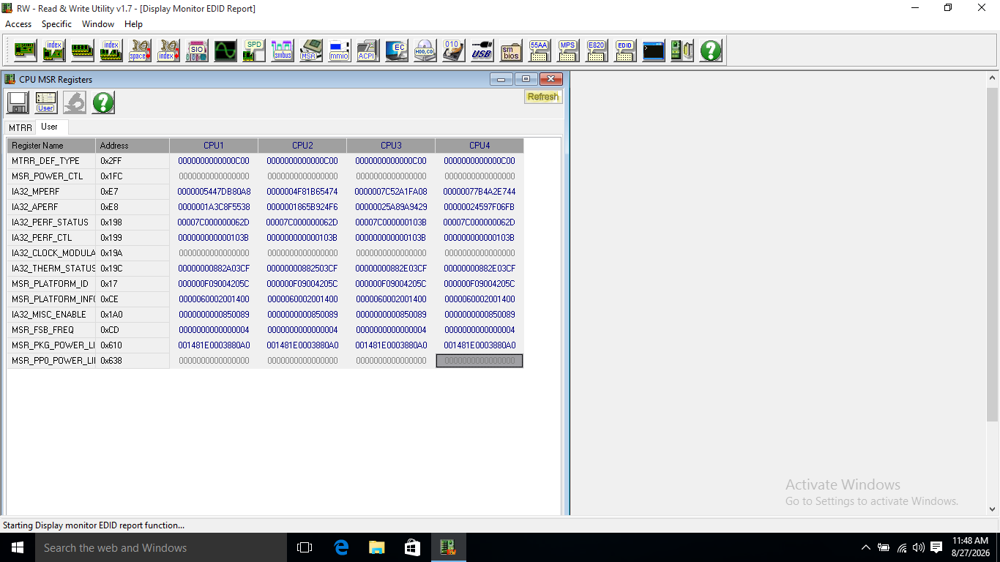
<div align="center">Image 4A: RWEverything window showing MSR values</div>

Relevant values from Image 4A will be copied over to Table 4B for reference.

| Register Address | Observed Value<br>(CPU 1) | Observed Value<br>(CPU 2) | Observed Value<br>(CPU 3) | Observed Value<br>(CPU 4) |
| ---------------- | ------------------------- | ------------------------- | ------------------------- | ------------------------- |
| 0x198            | 00007C000000062D          | 00007C000000062D          | 00007C000000103B          | 00007C000000062D          |
| 0x199            | 00007C000000103B          | 00007C000000103B          | 00007C000000103B          | 00007C000000103B          |
| 0x19C            | 00000000882A03CF          | 00000000882503CF          | 00000000882E03CF          | 00000000882E03CF          |
| 0x610            | 001481E0003880A0          | 001481E0003880A0          | 001481E0003880A0          | 001481E0003880A0          |
| 0xCE             | 0000060002001400          | 0000060002001400          | 0000060002001400          | 0000060002001400          |
| 0xCD             | 0000000000000004          | 0000000000000004          | 0000000000000004          | 0000000000000004          |
<div align="center">Table 4B: MSR values captured via RWEverything reflecting hardware throttling triggers</div>

The values in table 4B and Image 4A are 64 bit hexadecimal integers, which are meaningless in their raw form. The Intel SDM Vol 4 provides the bitfields for extracting useful data from these MSRs. Using these bitfields, values from the MSRs can be interpreted as meaningful information as done in table 4C:

| Register Name                 | Value(s) (hex)                                                   | Bit Field(s)                                                                                                                                                                                                                   | Comment(s)                                                                                                                                                                                                                                                                                                                                                                                                                                                                                                                                                                                                                                                                                                              |
| ----------------------------- | ---------------------------------------------------------------- | ------------------------------------------------------------------------------------------------------------------------------------------------------------------------------------------------------------------------------ | ----------------------------------------------------------------------------------------------------------------------------------------------------------------------------------------------------------------------------------------------------------------------------------------------------------------------------------------------------------------------------------------------------------------------------------------------------------------------------------------------------------------------------------------------------------------------------------------------------------------------------------------------------------------------------------------------------------------------- |
| MSR_FSB_FREQ<br>(0xCD)        | 0000000000000004                                                 | [3:0]                                                                                                                                                                                                                          | Scalable Bus Frequency: 0100b<br><br>Corresponds to 80MHz BCLK (SDM Vol. 4 Table 2-11)                                                                                                                                                                                                                                                                                                                                                                                                                                                                                                                                                                                                                                  |
| MSR_PLATFORM_INFO<br>(0xCE)   | 0000060002001400                                                 | [15:8]<br><br>[47:40]                                                                                                                                                                                                          | Maximum allowed non-turbo multiplier == 0x14 == 20<br><br>Maximum allowed non-turbo frequency == 20 * 80MHz<br><br>                  == 1600MHz<br><br>Minimum allowed multiplier == 0x06<br><br>                                                 == 6                                                                                                                                                                                                                                                                                                                                                                                                                                                                  |
| MSR_PKG_POWER_LIMIT (0x610)   | 001481E0003880A0                                                 | [14:0]<br><br>[15]                                                                                                                                                                                                             | [14:0] == 0x00A0 == 160<br><br>PL1 = 160 x (scaling factor)<br><br>  <br>Scaling factor is 0.125W here, as is common for modern intel chips<br><br>  <br><br>PL1 = 20W<br><br>[15] == 1<br><br>Power Limit 1 is active                                                                                                                                                                                                                                                                                                                                                                                                                                                                                                  |
| IA32_THERM_STATUS (0x19C)     | 00000000882A03CF<br><br>00000000882503CF<br><br>00000000882E03CF | [0]<br><br>  <br>  <br><br>[2]<br><br>  <br>  <br><br>[4]<br><br>  <br>  <br><br>[5]<br><br>  <br><br>[6]<br><br>  <br>  <br><br>[10]<br><br>  <br>  <br><br>[22:16]<br><br>  <br>  <br>  <br>  <br>  <br>  <br>  <br><br>[31] | [0] == 1<br><br>Currently Throttling (PROCHOT#)<br><br>  <br><br>[2] == 1<br><br>PROCHOT# actively asserted<br><br>  <br><br>[4] == 0<br><br>CPU has not passed Tjunction, 90°C<br><br>  <br><br>[5] == 0<br><br>CPU has not passed Tjunction since boot<br><br>  <br>[6] == 1<br><br>Current temperature is over threshold<br><br>  <br>[10] == 0<br><br>Power is not being capped<br><br>  <br><br>[22:16] Core1 == 0x2A == 42<br><br>Core 1 is 42°C away from Tjunction<br><br>  <br><br>[22:16] Core2 == 0x25 == 37<br><br>Core 2 is 37°C away from Tjunction<br><br>  <br><br>[22:16] Core3&4 == 0x2E ==46<br><br>Core 3 & 4 are 46°C away from Tjunction<br><br>  <br><br>[31] == 1<br><br>All readings are valid |
| IA32_PERF_CTL <br><br>(0x199) | 00007C000000103B                                                 | [15:8]                                                                                                                                                                                                                         | [15:8] == 0x10 == 16<br><br>Target Multiplier is 16x                                                                                                                                                                                                                                                                                                                                                                                                                                                                                                                                                                                                                                                                    |
| IA32_PERF_STATUS (0x198)      | 00007C000000062D<br><br>00007C000000103B                         | [15:8]                                                                                                                                                                                                                         | [15:8] Core 1&2&4 == 0x06 == 6<br><br>Core 1, Core 2, and Core 4’s Multiplier value is 6x (480MHz)<br><br>  <br><br>[15:8] Core 3 == 0x10 == 16<br><br>Core 3’s Multiplier value is 16x (1600MHz)                                                                                                                                                                                                                                                                                                                                                                                                                                                                                                                       |
<div align="center">Table 4C: Parsing of relevant MSR bitfields from MSR table 4B</div>

From the above information, the following conclusions can be made:
1. 80MHz is, indeed, the BCLK for this processor. This had been validated by cross-referencing values with other users who had the same processor in Hypothesis 1, but MSR 0xCD bits 3:0 help confirm this with empirical data from Intel’s official documentation.
2. MSR_PLATFORM_INFO returned 0x0000060002001400. Bits [15:8] explicitly define the Maximum Non-Turbo Ratio (0x14 = 20x). While bits [63:16] are categorized as reserved for the Airmont microarchitecture, byte 5 [47:40] contains 0x06, which directly mirrors the 6x minimum multiplier. This is interesting as the Goldmont microarchitecture (successor to Airmont) defines bits [47:40] as the LFM multiplier (low frequency mode), the highest performance per watt ratio. It’s noteworthy that the bits that hold the multiplier values for the highest performance per watt on the next generation of processors coincides with the multiplier my processor is enforcing while holding a low VCore value and throttling, though this doesn’t prove anything for certain.
3. The CPU has an active PL1 (sustained power limit) of 20W, which is plenty for a chip with a 6W TDP.
4. MSR 0x19C reveals that the system was undergoing throttling at the instant of observation, with PROCHOT# (or FORCEPR#) being actively pulled. FORCEPR# (Force Power Reduction) assertion is unlikely, since we have already ascertained that the processor is drawing extremely low voltage (and therefore low power) as seen in Table 1A. However, according to bits 4 and 5, the system had not crossed Tjunction (maximum allowed temperature on the processor die), and yet the processor was also over Thermal Threshold 1, despite the highest core temperature being 53°C (Core 2), which was completely normal, and at a 37°C gap from Tjunction. This contradiction between what the hardware is reporting and what the firmware believes points at a BD_PROCHOT, as this throttling is likely due to external factors.
5. The OS was requesting a P-State with 16x multiplier, however, as seen in 0x198 [15:8], Cores 1, 2, and 4 were at 480MHz, but Core 3 was able to boost to 1600MHz. This proves nothing beyond what was already proved in Hypothesis 2: The processor seems to be able to clock above 480MHz, but only momentarily, and only while idle.

In spirit and in mechanism, Hypothesis 3 was correct. Something is triggering PROCHOT# externally,  since it’s unlikely to be the CPU itself (internal PROCHOT#) as all core temps are well below Thermal Junction. Either a bug in the EC or a degraded physical component is triggering BD_PROCHOT, and thus asserting the PROCHOT# trip.

### Hypothesis 5:
Taking into account the contradicting values obtained from the MSRs in Hypothesis 4, it is possible that the CPU throttling is caused by physical hardware damage or component degradation on the motherboard, rather than a SoC thermal or power trip.

#### Investigation:
It is worth noting that BD_PROCHOT can be asserted for more than just overheating components on the board, as mentioned in the statement for Hypothesis 3. The common causes for a BD_PROCHOT assertion are:

A. Faulty/Non-Genuine Adapters: Not the case here, as a new Acer charger is being used to power this laptop.

B. Exceeding Power Limits: The Intel Pentium N3710 has a TDP of 6W, and as seen from 0x610 bits [14:0] and [15], the power limit is 20W and is being enforced.

C. Overheating Components: Disproved by 0x19C bits [4],[5], [22:16], and [31], yet being supported by bits [0],[2],[6], and [31].

Reason C directly contradicts itself. The PROCHOT# trip is being asserted, the temperature is over the thermal threshold, yet the processor’s die temperatures are staying relatively cool and at a large delta from Tjunction, as established in the conclusion of Hypothesis 4. To progress from here, the physical path of a PROCHOT# trip due to an external factor needs to be traced on the physical motherboard in hopes of finding a visible defect.

For this, a schematic of the motherboard (Wistron Domino BA14285-1) and a boardview file is needed.

Because board schematics and CAD layouts (and by extension, boardview files) for ODM platforms are proprietary and rarely publicly available, sourcing the exact schematics and layout files took a while.

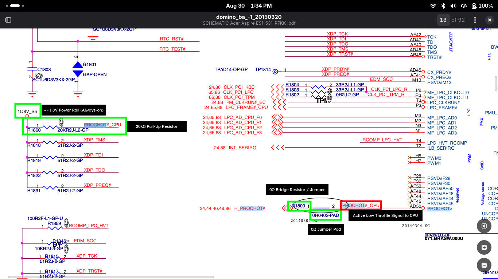
<div align="center">Image 5A: Annotated Schematic of processor I/O, detailing components relevant to PROCHOT#. R1860 is the primary suspect here, since abnormal behavior by R1860 (20kΩ pull up resistor responsible for keeping PROCHOT# at 1.8V) would result in a false positive PROCHOT# trip.</div>

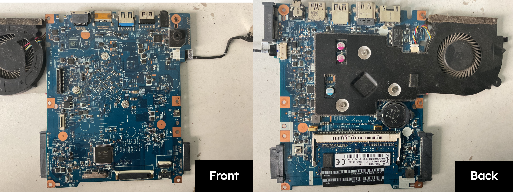
<div align="center">Image 5B: Collated view of motherboard.</div>

By cross-referencing the physical silkscreen markings on the board with the motherboard’s CAD file in OpenBoardView, I located PROCHOT#’s pull-up circuit.

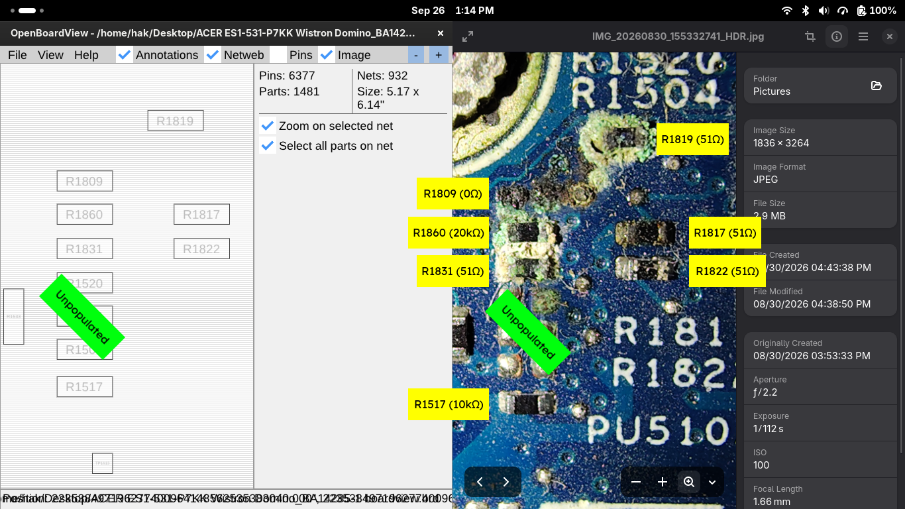
<div align="center">Image 5C: Left: OpenBoardView CAD layout of the PROCHOT# pull-up circuit Right: Annotated macro photo of corresponding SMD resistors and their resistances.</div>

As visible in Image 5C, both R1860 and R1809, alongside other resistors in the surrounding area have been heavily oxidized and have undergone severe corrosion, with R1809 being completely disintegrated. This strongly implicates the pull-up circuit, R1860 in particular, in the assertion of PROCHOT#.

While I do not have the experience or knowledge to accurately explain the observations made in Hypothesis 2’s investigation, I can make an educated guess. Refer to Appendix 1 for further information.

### Reflection:
While I likely have isolated the fault, fixing it is a different problem. R1809 and R1860 are 0402 Surface Mount Devices (1.0mm × 0.5mm), and reworking them requires skill and equipment I don't have. This is work for professionals with the appropriate tooling, and foolishly trying to use regular cheap soldering equipment would very likely make the device into a paperweight.

# Exploring Repair Options:
Given the observations made above, it would be most sensible to get a technician to properly remove R1860 and R1809, clean the corroded pads, repair the trace (for R1809), and replace the resistors. However, this was unfeasible for me due to economical and geographical reasons.

## Option 1; Disabling TM1 and TM2:
The documentation for the N-series Intel® Pentium® Processors and Intel® Celeron® Processors implies that Thermal Monitor 1 and Thermal Monitor 2, the mechanisms responsible for throttling could be disabled, and doing so should theoretically disable the throttling mechanism used by the PROCHOT# trip.

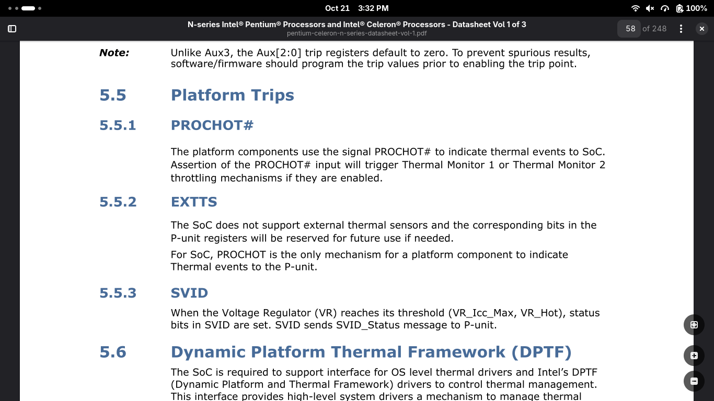
<div align="center">Image O1A: Datasheet for N-series Intel® Pentium® Processors and Intel® Celeron® Processors, section 5.5.1: PROCHOT# states: “Assertion of the PROCHOT# input will trigger Thermal Monitor 1 or Thermal Monitor 2 throttling mechanisms if they are enabled”</div>

The Intel® 64 and IA-32 Architectures Software Developer Manuals Volume 4 details that the Automatic TCC (Thermal Control Circuit) can be disabled by clearing bit three of MSR 0x1A0. (Refer Appendix 2 for more details).

Unfortunately, disabling TCC failed to affect TM1 and TM2 (Refer Appendix 2 for more details), and thus, this is not a viable repair option.

## Option 2; Overwriting NVRAM variables to disable BD_PROCHOT:
If disabling the processor’s throttling mechanism doesn’t work, we need to find a way to make the CPU disregard the external PROCHOT# trip entirely, since there is no way to alter the P-unit’s code (aka PCU, a microcontroller on the CPU responsible for several low level functions, which includes the throttling we see) in a feasible manner to make it ignore the incoming PROCHOT#, as it is cryptographically signed.

The NVRAM (Non-Volatile Random Access Memory) holds the configuration used by the BIOS to set up the processor at boot (Refer Appendix 3 for more info). Dumping the BIOS and loading it into a program called [UEFITool](https://github.com/longsoft/uefitool), and searching for the keyword “PROCHOT” yields several results, mainly within setuputility/PE32 Image section (a PE32 image section is essentially an executable).

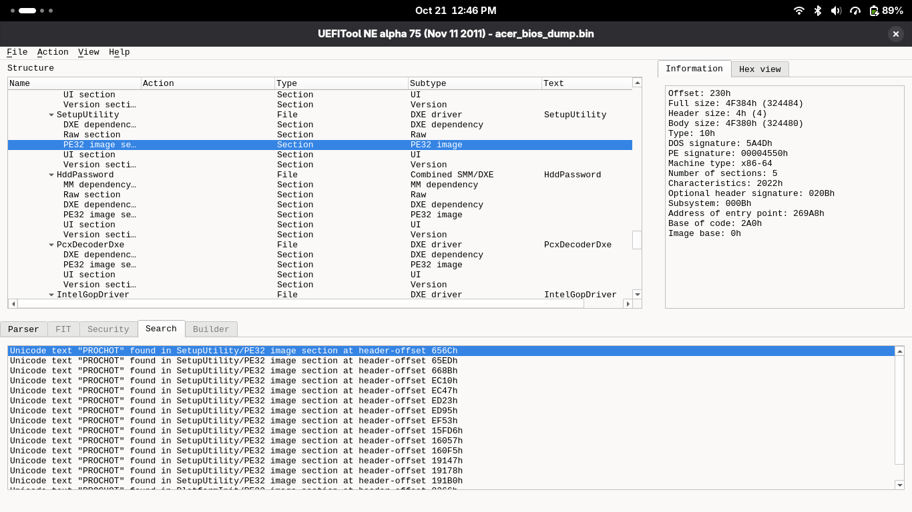
<div align="center">Image O2A: Screenshot of UEFITool displaying search results of “PROCHOT” in the dumped BIOS file</div>

Extracting the PE32 Image Section, we get a .efi file, a compiled UEFI binary from which IFR’s (Internal Form Representation) can be extracted. This describes the menus, options, strings, and settings that are displayed in a BIOS menu. However, it is worth noting that the IFR does not hold the current values for anything, rather, the BIOS loads the text and placeholder material from an IFR, whereas the NVRAM holds the default and current settings.

[IFRExtractor](https://github.com/LongSoft/IFRExtractor-RS), a tool used for extracting the IFR from UEFI Binaries created nine text files from the extracted PE32 Image Section. Each holding a different page (Such as ‘thermals’, ‘power’, or even just language variants). Of the nine files, two mentioned the word “PROCHOT”; “Advanced”, and “Power”, both of which were never visible when accessing the BIOS.

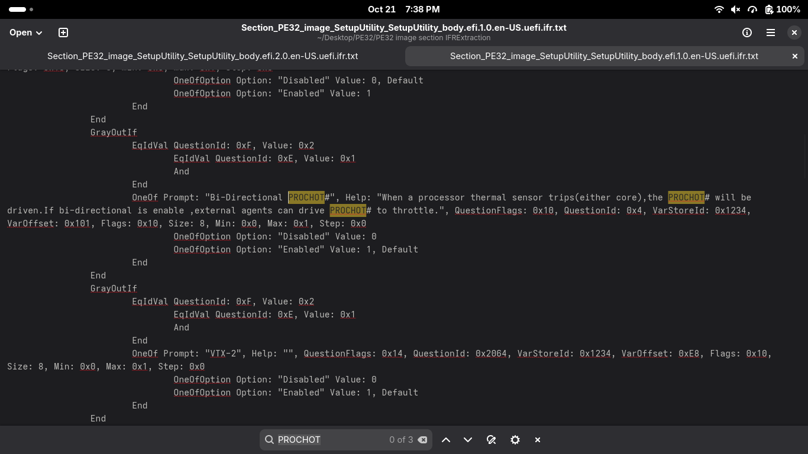
<div align="center">Image O2B: Extracted IFR for the “Power” page, reflecting 3 results for “PROCHOT”</div>

‘OneOf Prompt: “Bi-Directional PROCHOT#” reflects a selection menu, had Acer not disabled this page. The ‘Help’ section is a description of the feature, and it reads “When a processor thermal sensor trips(either core),the PROCHOT# will be driven.If bi-directional is enable ,external agents can drive PROCHOT# to throttle.” This is precisely the feature we need, and ‘VarStoreId’ and ‘VarOffset’ reflect the data structure where the setting is held and the offset at which the setting is stored (0x101). Here, the offset is at byte index 257, the 258th byte, and ‘size’ reflects that the corresponding variable is 8 bits (1 byte) in size.

In theory, rewriting the NVRAM, which is where the BIOS settings are saved, to reflect 0x0 at address 0x101 in data structure 0x1234, or the Setup region, should theoretically disable the ‘bi-directional’ aspect of BD_PROCHOT.

However, booting into a UEFI shell and attempting to write to NVRAM variables at VarOffset 0x101 within VarStoreId 0x1234 (found in the Power - - - > Advanced CPU Control menu) resulted in a “WRITE_PROCTECTED” error, despite the BIOS SPI region lock (VarOffset 0x208) being disabled, (NVRAM variables often live in the BIOS region of the SPI flash chip on modern systems).

When the UEFI shell tries to write to NVRAM by calling the SetVariable() function, it calls the VariableSmmRuntimeDxe driver, which forwards the request to the VariableSmm UEFI driver, which helps interact securely with NVRAM variables by ensuring no unauthorized changes are made to NVRAM (see Appendix 3 for more info), and  is likely blocking our write request.

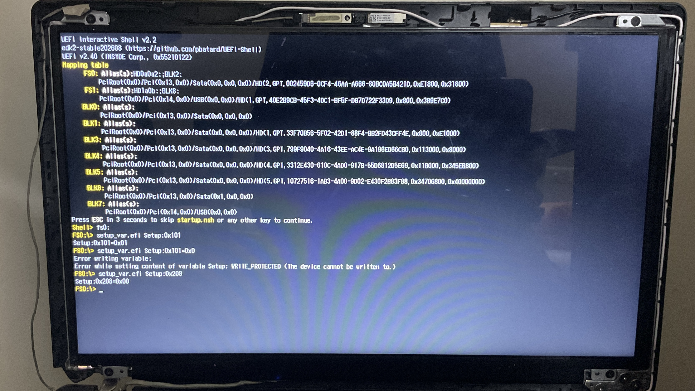
<div align="center">Image O2C: UEFI Shell reflecting error writing to VarOffset 0x101 and 0x208 reflecting 0.</div>

The only way to write to NVRAM while VariableSmm is actively preventing it is to flash the SPI chip externally while the system is powered off. However, if this is the route to be taken, I’d rather flash an unlocked image of the BIOS that exposes all the hidden settings available in the BIOS menu.

## Option 3; Using Linux’s pinctrl-cherryview driver to switch PROCHOT_B from Native Mode to GPIO mode:
If we can’t get the processor to ignore external PROCHOT# trips, we can try disconnecting PROCHOT_B (this is different from AD50; see Appendix 4) from the PROCHOT#\_CPU line entirely. This is because modern processor pins are not simply hardwired to their BGA connections. Rather, these BGA balls and the processor's internal logic sit behind a programmable hardware multiplexer capable of switching pins between their native hardware function and GPIO modes.

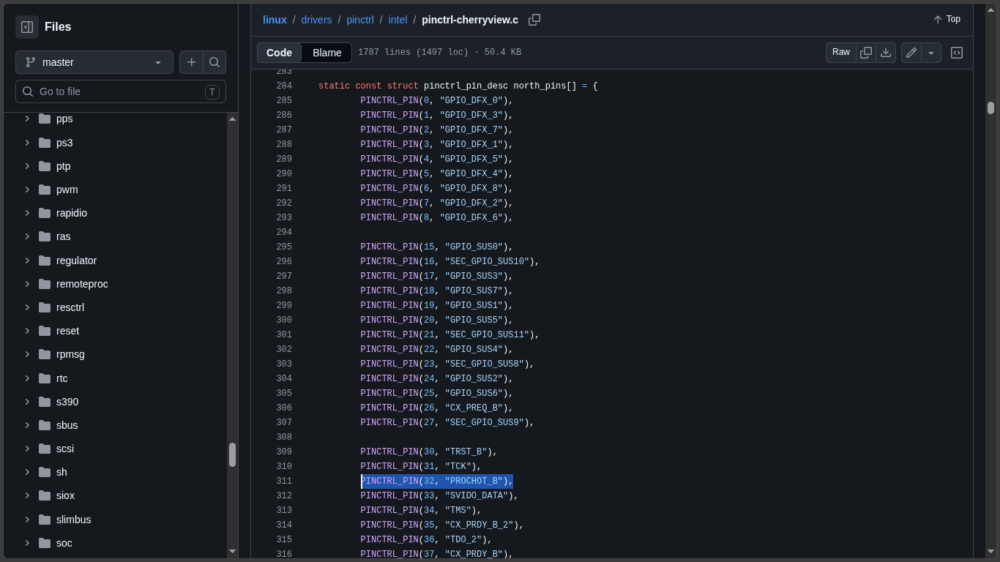
<div align="center">Image O3A: Intel’s pinctrl-cherryview driver for GPIO control of Cherryview/Braswell SoCs. Note that PROCHOT_B is pin 32 (line 311) in the north community (line 284).</div>

The ACPI HID for the Braswell GPIO controller is INT33FF (see Appendix 4 for more info), and each community has an index. PROCHOT_B is the 32nd pin in the north community. To find its global GPIO pin number, we need to first find the index for the north community.

Terminal Logs and Commands Executed:
```bash
hak@antix1:~
$ sudo mount -t debugfs debugfs /sys/kernel/debug
```

```bash
hak@antix1:~
$ sudo grep -E "INT33FF|cherryview" /proc/iomem
fed80000-fed87fff : INT33FF:00
  fed80000-fed87fff : INT33FF:00 INT33FF:00
fed88000-fed8ffff : INT33FF:01
  fed88000-fed8ffff : INT33FF:01 INT33FF:01
fed90000-fed97fff : INT33FF:02
  fed90000-fed97fff : INT33FF:02 INT33FF:02
fed98000-fed9ffff : INT33FF:03
  fed98000-fed9ffff : INT33FF:03 INT33FF:03
```

```bash
hak@antix1:~
$ sudo grep -rn "PROCHOT" /sys/kernel/debug/pinctrl/ /sys/kernel/debug/gpio 2>/dev/null
/sys/kernel/debug/pinctrl/INT33FF:01/pinconf-pins:27:pin 32 (PROCHOT_B): input bias disabled, output drive push pull
/sys/kernel/debug/pinctrl/INT33FF:01/pinmux-pins:27:pin 32 (PROCHOT_B): (MUX UNCLAIMED) INT33FF:01:642
/sys/kernel/debug/pinctrl/INT33FF:01/pins:26:pin 32 (PROCHOT_B) 32:INT33FF:01 GPIO 0x00018102 0x05c00000
```

Evidently, PROCHOT_B is in ‘INT33FF:01’, and from Image O3A, we know that PROHOT_B is the 32nd pin in the North community. Thus, the North Community’s index is 01. Furthermore, INT33FF:01 has a base ID of 610 (see Appendix 4). Thus, PROCHOT_B has a GPIO pin number of 642 (610+32). With this, we can use sysfs to configure the pin from native hardware mode (PROCHOT_B connected to AD50, which is connected to the PROCHOT#\_CPU trace and thus R1860) to GPIO mode. This essentially tells the multiplexer to disconnect PROCHOT_B from PROCHOT#\_CPU and in theory allows us to set PROCHOT\_B to whatever state we desire with the following commands:

```bash
echo 642 | sudo tee /sys/class/gpio/export && echo high | sudo tee /sys/class/gpio/gpio642/direction
```

The above command instructs the kernel to add GPIO pin 642 to the ‘GPIO export file’, which allocates the pin for userspace usage. The second command sets the pin to output (TX) and sets it to logic high in one go (this could also be done in two commands by writing ‘out’ to /sys/class/gpio/gpio642/direction, and then ‘1’ to /sys/class/gpio/gpio642/value. The reason this is not done is to not leave the pin in an unconfigured state in the time it takes to run these commands sequentially).

Indeed, this successfully unlatched the processor from its throttled state and allowed it to clock to its proper frequencies. It is important to note that we have essentially de-fanged BD_PROCHOT itself. However, since R1809 was missing to begin with, there was no way for BD_PROCHOT to be asserted anyway, since the circuit to the EC and other components was open. This fix also doesn’t disable the processor’s internal throttling mechanisms, as that treats PROCHOT_B as TX (output), and doesn’t really depend on its state for throttling the processor.

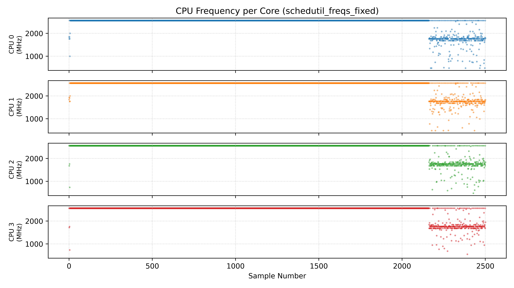
<div align="center">Graph O3A: Frequency-Sample graph under load (default governor)</div>

Graph O3A shows the new frequencies under the exact same testing conditions as Graph 2B. Once again, a part of the graph shows apparently random values, but this again can be attributed to the 5 minute stress test ending before the logger, and even the ‘random’ values appear to be far above the 0.48GHz floor previously observed. Furthermore, under load, all cores appear to be locked to 2.56GHz, showing that the processor can now run at full speeds.

However, this is not truly a fix. At most, it can be called a patch, since it needs to be run on every boot (even if the process of executing the commands can be automated by creating a service), since this is limited solely to Linux, since doing the same for Windows would require writing complex drivers. This would be a massive waste of time since this driver would still need to be installed on every single major version of Windows I install, requiring multiple rewrites, and would not persist across reinstallations. It would simply be more efficient to dump the BIOS using an external SPI flasher and modify it to show all the hidden settings explored in Repair Option #2, and then externally flashing the BIOS chip (therefore bypassing write protection). Successfully doing that would allow me to disable and enable the bidirectional part of BD_PROCHOT as I please, and reveal many hidden settings that would help me understand the functions of a BIOS even further.

## Appendix 1:
When Idle, the CPU cores enter deep-idle C states, where its internal clock is essentially ‘turned off’, a process called gating. When an interrupt briefly requires the core to do work, the ‘sleeping’ core is ‘turned on’ and resumes normal function.

When we poll a deep-idle core, it is possible that the kernel reports the last requested target frequency while the core is asleep. It wasn’t an intermittent assertion of BD_PROCHOT, but rather the software lying and reporting what it expected to see. 

In a healthy system, this software fallback goes unnoticed because the moment the core is active, it instantly shoots up to meet that requested target frequency; here, however, it gives us values that imply that the CPU performs healthily when idle. 

When all 4 cores are locked in C0 (100% active state), the system reports actual frequencies, which reflect severe throttling, as seen in Graphs 2B and 2C.

==🟡It should be noted that this is an educated guess given the information obtained and certainly not a decisive conclusion.==

## Appendix 2:
The Intel SDM Volume 4 documents MSR 0x1A0, otherwise known as “IA32_MISC_ENABLE”, whose 3rd bit is the “Automatic Thermal Control Circuit Enable (R/W)” bit, set to zero by default (on Airmont and Silvermont processors). However, upon retrieving its value (0x850089), it became apparent that the third bit was set to one, and therefore, TM1 and TM2 were enabled. It turns out that BIOS manufacturers often enable TM1 and TM2 by default.

Using the wrmsr command, I overwrote the third bit of MSR 0x1A0 to reflect 0 using the following command:

```bash
sudo wrmsr 0x1A0 0x850081
```

Reading MSR 0x1A0 now reflected “850081”, confirming that the changes had taken place. However, no change was observed in the throttling behavior exhibited by the CPU.

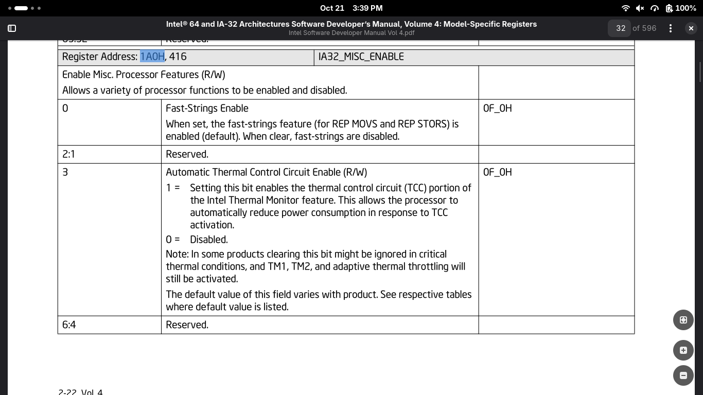
<div align="center">Image A2A: Intel SDM Vol 4’s documentation on MSR 0x1A0</div>

While the SDM did indeed mention that “in some products clearing this bit might be ignored in critical thermal conditions,” I had hoped that the assertion of BD_PROCHOT would not be considered a ‘critical thermal condition’. However, it makes sense why a PROCHOT# trip would be responded to with extreme precaution, as it is the literal mechanism responsible for ensuring the silicon doesn’t cook itself.

## Appendix 3:
* When a x86_64 device’s CPU cores power up, they’re in an unconfigured state. The CPU is hardcoded to point to the reset vector (often 0xFFFFFFF0), and begins loading the IBB (Initial Boot Block), which contains BIOS code.
* The BIOS stored on the SPI flash chip follows a strict initialization sequence. To understand why Repair Option #2 failed, the following steps of the UEFI Platform Initialization sequence must be understood:
	* NOTE: The following breakdown distills the UEFI PI sequence to the memory mapping, driver loading, and security boundaries relevant to our write-protection roadblock so as to not overcomplicate the appendix with the several granular sub-phases and model specific quirks in this process.
	* SEC (Security) Phase:
		* Sets up up CAR (Cache-as-RAM) as system RAM is uninitialized
		* Establishes Hardware Root of Trust
	* PEI (Pre-EFI-Initialization) Phase:
		* Wakes up the CPU, chipset and other components
		* Memory Training
		* Allocates SMRAM (System Management RAM), an isolated region of DRAM reserved for the CPU for when it’s in SMM.
	* DXE (Driver Execution Environment) Phase:
		* This is the phase where the entire system gets ‘connected’ and properly communicates.
		* GOP (Graphics Output Protocol) is loaded.
		* VariableSmm and VariableSmmRuntimeDxe are initialised here. The former is the ‘back-end’ SMI (System Management Interrupt, responsible for raising the CPU into System Management Mode, where regular execution is frozen so that the CPU can handle critical tasks). However, it is not accessible to the regular OS; VariableSmmRuntimeDxe is the ‘front-end’ through which the OS requests writes to write-protected regions of the SPI Flash, and the VariableSmmRuntimeDxe driver then calls a function that passes data to the VariableSmm driver, which verifies the legitimacy of the write and either rejects or allows the write.
		* CPU reads setup configuration data from NVRAM data structures and becomes ready for full fledged execution.
		* In the last few steps of the DXE phase, the entire BIOS space (including NVRAM variables) is locked using either the BCRs (BIOS Control Registers) or SMM-Protected Range Registers. Write operations after this point will need approval from the VariableSmm driver.
	* BDS (Boot Device Selection) Phase:
		* GOP (Graphics Output Protocol) is used to wake up the GPU and initialize the display.
		* This is the phase where the F2 BIOS menu is made accessible, alongside other features like the F12 Boot Menu (keys vary depending on vendor).
		* Reads NVRAM to obtain boot priority, security enforcements, etc.
		* Device Discovery (looks for bootable devices)
		* Executes the loader (bootmgfw.efi or grubx64.efi)

## Appendix 4:
* AD50 is the alphanumeric coordinate on the CPU’s BGA which refers to the physical CPU contact through which PROCHOT\_B is connected to the PROCHOT#\_CPU trace on the motherboard via the multiplexer.
* PROCHOT_B is part of the CPU’s internal circuitry and sits on the other side of AD50 through the multiplexer. Thus, shifting the multiplexer from AD50 (Native Mode) to GPIO Mode via sysfs unlatched the processor as it cut the incoming signal that would otherwise result in a PROCHOT# trip.
* INT33FF is the ACPI Hardware ID (HID) used by the Advanced Configuration and Power Interface standard to identify hardware connected to a motherboard. Intel CPU’s often group pins into ‘communities’ such as southwest, north, east, and southeast.

Terminal Logs and Commands Executed to obtain GPIO Controller information:

```bash
hak@antix1:~
$ sudo cat /sys/kernel/debug/gpio
gpiochip0: GPIOs 512-609, parent: platform/INT33FF:00, INT33FF:00:

gpiochip1: GPIOs 610-682, parent: platform/INT33FF:01, INT33FF:01:

gpiochip2: GPIOs 683-709, parent: platform/INT33FF:02, INT33FF:02:

gpiochip3: GPIOs 710-795, parent: platform/INT33FF:03, INT33FF:03:

gpiochip4: GPIOs 796-798, parent: platform/INT0002:00, INT0002 Virtual GPIO:
 gpio-798 (                    |ACPI:Event          ) in  lo IRQ
```

It is visible that INT33FF:01’s first pin is 610; thus, INT33FF:01’s base ID is 610. As we know from Image O3A, INT33FF:01 corresponds to the North Community GPIO controller on the CPU.
